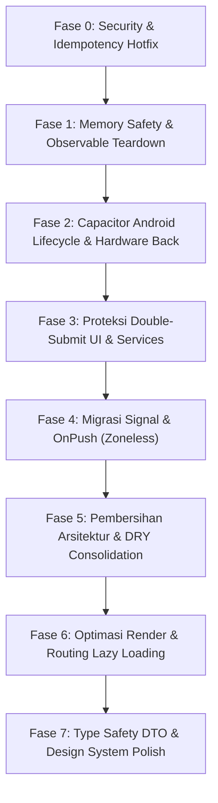

# 📋 COMPREHENSIVE CODEBASE AUDIT REPORT — WAREHOUSE V2

> **Standards Baseline**: `.agents/AGENTS.md` (Angular 21 Zoneless, TypeScript 5.9+, Tailwind CSS v4, Capacitor 8+ Android, SignalR).  
> **Audit Date**: 16 Oktober 2026  
> **Status**: Read-Only Audit Complete  
> **Scope**: `src/app/` (features, core, shared, layouts), `angular.json`, `capacitor.config.ts`, `src/environments/`, `src/styles.css`.

---

## 1. Ringkasan Skor Kesehatan Codebase

| # | Aspek Audit | Skor (1-10) | Critical | Medium | Low | Total Temuan |
|---|---|:---:|:---:|:---:|:---:|:---:|
| 1 | Standar Modern Angular 21 & Zoneless Readiness | **3 / 10** | 34 | 101 | 4 | 139 |
| 2 | Memory Leaks, RxJS & SignalR Lifecycle | **3 / 10** | 3 | 79 | 3 | 85 |
| 3 | Arsitektur, Modularitas & Reusability (DRY) | **4 / 10** | 11 | 15 | 6 | 32 |
| 4 | Performa Render & Kesiapan Capacitor Android | **3 / 10** | 18 | 59 | 11 | 88 |
| 5 | Keamanan Jaringan & Idempotency | **2 / 10** | 6 | 8 | 3 | 17 |
| 6 | Type Safety & Kepatuhan Design System | **3 / 10** | 14 | 7 | 5 | 26 |
| **TOTAL** | **Kesehatan Keseluruhan Codebase** | **3.0 / 10** | **86** | **269** | **32** | **387** |

---

## 2. Temuan Kritis (High Priority)

> **Dampak Kritis**: Berpotensi menyebabkan kebocoran kredensial, manipulasi data ganda (double-submit) di backend ERP, memory leak permanen yang mengakibatkan crash pada Android WebView, serta hilangnya sinkronisasi tampilan UI pada mode Angular Zoneless.

### 2.1. Keamanan & Idempotency Cacat Arsitektur
1. **`src/environments/environment.ts:3-19`** & **`src/environments/environment.development.ts:3-21`**
   - **Masalah**: Hardcoded credentials production dan development secara plaintext di git repository.
   - **Detail**: Termasuk private IP (`192.168.1.10`, `192.168.1.15`), username/password akun POS (`interface` / `P@ssw0rd!@#`), password IdentityServer4 (`(4b88HQ~W@tDak"=`, `QwertY!23`), serta `is4ClientID` dan `is4ClientSecret`.
2. **`src/app/app.routes.ts:10-13`**
   - **Masalah**: Kredensial akun POS diekspos secara publik di metadata route `data: { username, password }`, dapat diinspeksi lewat devtools/router state.
3. **`src/app/core/interceptors/auth.interceptor.ts:23-25`**
   - **Masalah**: Cacat logika idempotency key. Setiap request mutasi HTTP (`POST`, `PUT`, `DELETE`, `PATCH`) menghasilkan UUID baru via `idempotencyService.generateKey()`.
   - **Dampak**: Jika user menekan tombol dua kali atau terjadi network retry, backend menerima UUID berbeda dan menganggapnya sebagai 2 transaksi terpisah. Fitur anti-double-submit menjadi tidak berfungsi sama sekali.
4. **Operasi Mutasi Kritis Tanpa Loading Lock / Proteksi Double-Submit**:
   - `src/app/features/goods-delivery/pages/goods-delivery-detail/goods-delivery-detail.component.ts:61-79`: `onSubmit()` (menyimpan pengiriman mobil) tidak pernah mengubah flag `isLoading = true`. Tombol konfirmasi dialog tetap aktif saat HTTP request berjalan.
   - `src/app/features/route-group/pages/route-group-form/route-group-form.component.ts:130-146`: `onSubmit()` membuat jalur muat baru tanpa loading lock; double-click membuat grup ganda.
   - `src/app/features/request-receive/pages/request-receive-checklist/request-receive-checklist.component.ts:359-400`: `onConfirmReceive()` mengirim `putReceiveDocnum()` tanpa proteksi inflight request.
   - `src/app/features/route-group/pages/route-group-detail/route-group-detail.component.ts:351-378, 380-415, 548-570`: Operasi urutkan BON (`changeOrderBON`), mobil siap jalan (`postFinishRouteGroup`), dan hapus BON (`deleteRouteGroup`) tidak memiliki locking state.

### 2.2. Memory Leaks Permanen (Infinite Observables)
Stream dari `ActivatedRoute` bersifat *infinite* (tidak pernah complete saat komponen dihancurkan). Tanpa teardown, instance komponen tertahan di memori selamanya:
1. **`src/app/features/auth/pages/login/login.component.ts:56`**: `this.route.data.subscribe(...)` di `ngOnInit` tanpa `takeUntilDestroyed()`.
2. **`src/app/features/goods-delivery/pages/goods-delivery-detail/goods-delivery-detail.component.ts:39`**: `this.route.paramMap.subscribe(...)` tanpa unsubscribing; akumulasi listener saat navigasi berulang.
3. **`src/app/features/inventory-request/pages/inventory-request-view/inventory-request-view.component.ts:41`**: `this.route.paramMap.subscribe(...)` memicu request HTTP berulang tanpa lifecycle management.

### 2.3. Zoneless-Breaking Mutations (34 Komponen)
Dalam Angular 21 dengan Zoneless Change Detection (`provideZonelessChangeDetection()`), mutasi properti biasa (`this.prop = val`) di dalam async callback tidak memicu re-render template.
- **Top Pelanggar**:
  - `src/app/features/route-group/pages/route-group-detail/route-group-detail.component.ts:97, 115, 178, 260`
  - `src/app/features/route-group/pages/route-group-detail-history/route-group-detail-history.component.ts:68, 110, 175, 257`
  - `src/app/features/loading/pages/loading-checklist/loading-checklist.component.ts:109, 130, 220`
  - `src/app/features/picking/pages/picking-list/picking-list.component.ts:61, 95, 135`
  - `src/app/features/picking/pages/picking-checklist/picking-checklist.component.ts:131, 219`
  - `src/app/features/checkout/pages/checkout-detail/checkout-detail.component.ts:79, 120`
  - Serta 28 halaman/fitur lainnya (pola mutasi `this.isLoading = false`, `this.salesInvoices = data` langsung di dalam `.subscribe()`).
- **Penyalahgunaan `effect()`**:
  - `src/app/shared/components/dialog-set-pic/dialog-set-pic.component.ts:25-29`: Menggunakan `effect()` untuk sinkronisasi state input ke writable signal (seharusnya menggunakan `linkedSignal()`).

### 2.4. Kesiapan Capacitor Android Kritis
1. **`package.json:21`**: `@capacitor/app` belum terpasang. Aplikasi tidak bisa menangkap event hardware back button Android maupun native app lifecycle.
2. **`src/app/app.ts:10`**: Tidak ada penanganan tombol hardware Back. Di Android, menekan tombol Back langsung menutup aplikasi tanpa konfirmasi atau membatalkan dialog.
3. **`src/index.html:7`**: Meta viewport tidak menyertakan `viewport-fit=cover`, mengakibatkan nilai `env(safe-area-inset-*)` bernilai `0px`.
4. **`src/styles.css:1-255`**: Seluruh bottom navigation bar fixed (`.nav-wrap`, `app-navbar`, dll.) tidak memiliki padding safe-area bottom (`env(safe-area-inset-bottom)`), sehingga menabrak gesture navigation bar Android.
5. **`src/app/core/services/signalr.service.ts:215-235`**: Sinkronisasi SignalR hanya memakai DOM `visibilitychange` dan `window.online`. Saat Android masuk Doze mode / background, koneksi socket drop tetapi status internal tetap dianggap connected, menyebabkan data real-time tidak pernah update saat aplikasi dibuka kembali.

### 2.5. Pelanggaran Batas Arsitektur & God Components
1. **Cross-Feature Imports Ilegal**:
   - `src/app/features/route-group/pages/route-group-form/route-group-form.component.ts:15`: Import langsung `LoadingService` dari `features/loading`.
   - `src/app/features/route-group/pages/route-group-detail/route-group-detail.component.ts:8`: Import langsung `LoadingService`.
   - `src/app/features/route-group/pages/route-group-detail-history/route-group-detail-history.component.ts:8`: Import langsung `LoadingService`.
   - `src/app/features/inventory-request/pages/inventory-request-view/inventory-request-view.component.ts:8`: Import langsung `ReqTransLoadingService` dari `features/request-transfers`.
2. **God Components & 98% Twin Duplication**:
   - `src/app/features/route-group/pages/route-group-detail/route-group-detail.component.ts` (**693 baris**) dan `src/app/features/route-group/pages/route-group-detail-history/route-group-detail-history.component.ts` (**682 baris**) adalah 98% duplikat (hampir 1.375 baris kode kembar yang dipelihara terpisah).
   - `src/app/features/loading/pages/loading-checklist/loading-checklist.component.ts` (**588 baris**) & `src/app/features/request-transfers/pages/reqtrans-loading-checklist/reqtrans-loading-checklist.component.ts` (**555 baris**) memuat logika SignalR, regex parsing, validasi form, dan UI state sekaligus.
3. **Direct `localStorage` Access**:
   - Direct `localStorage.setItem` / `getItem` digunakan di `route-group-detail.component.ts:577`, `route-group-detail-history.component.ts:566`, `reqtrans-goods-delivery-form.component.ts:83`, dan `checkout-detail.component.ts:168`, mengabaikan `StorageService` yang terintegrasi dengan Capacitor Preferences.

### 2.6. Type Safety Rusak & Unsafe Casts
1. **Mock Initialization Berbahaya**:
   - `src/app/features/picking/services/picking.service.ts:22` & `src/app/features/loading/services/loading.service.ts:28`:
     `new BehaviorSubject<Detail>({} as Detail)`
     Membuat object kosong dipaksa sebagai `Detail`. Akses child property sebelum data didapat akan memicu runtime `TypeError`.
2. **Pengecekan Tipe Dipaksa (`as any`)**:
   - `src/app/features/route-group/pages/route-group-additional-invoice/route-group-additional-invoice.component.ts:195`: `Details: dataToAdd as any`
   - `src/app/features/route-group/pages/route-group-detail/route-group-detail.component.ts:331, 360, 561`: Injeksi ad-hoc `(headerRes as any).newlyAdded` dan `payload as any`.
   - `src/app/features/inventory-request/pages/inventory-request-view/inventory-request-view.component.ts:146`: `this.transportUnitModel as any`.

---

## 3. Temuan Menengah (Medium Priority)

### 3.1. Kebocoran Memori HTTP Subscriptions (77 Kasus Unprotected)
Meskipun HTTP observable umumnya auto-complete, callback yang terlambat diterima setelah komponen di-destroy tetap berjalan di detached views dan memicu memory leak atau error toast tak terduga.
- **Daftar Komponen & Baris**:
  - `src/app/features/auth/pages/login/login.component.ts`: 68, 101, 115, 126, 135 (5 calls)
  - `src/app/features/route-group/pages/route-group-form/route-group-form.component.ts`: 136, 173, 209 (3 calls)
  - `src/app/features/route-group/pages/route-group-additional-invoice/route-group-additional-invoice.component.ts`: 53, 73, 99, 198 (4 calls)
  - `src/app/features/route-group/pages/route-group-detail/route-group-detail.component.ts`: 110, 174, 257, 360, 397, 428, 461, 485, 561, 574, 592, 605 (12 calls)
  - `src/app/features/route-group/pages/route-group-detail-history/route-group-detail-history.component.ts`: 107, 172, 254, 357, 393, 423, 456, 479, 550, 563, 581, 595 (12 calls)
  - `src/app/features/checkout/pages/checkout-list/checkout-list.component.ts`: 124 (1 call)
  - `src/app/features/goods-delivery/pages/goods-delivery-detail/goods-delivery-detail.component.ts`: 68, 88, 111 (3 calls)
  - `src/app/features/finished/pages/finished-list/finished-list.component.ts`: 122 (1 call)
  - `src/app/features/finished/pages/finished-detail/finished-detail.component.ts`: 45 (1 call)
  - `src/app/features/request-receive/pages/request-receive-list/request-receive-list.component.ts`: 51, 76, 97 (3 calls)
  - `src/app/features/request-receive/pages/request-receive-detail/request-receive-detail.component.ts`: 41, 70 (2 calls)
  - `src/app/features/request-receive/pages/request-receive-checklist/request-receive-checklist.component.ts`: 102, 124, 286, 312, 388 (5 calls)
  - `src/app/features/request-receive/pages/request-receive-list-processed/request-receive-list-processed.component.ts`: 54 (1 call)
  - `src/app/features/request-receive/pages/request-receive-history/request-receive-history.component.ts`: 52 (1 call)
  - `src/app/features/request-receive/pages/request-receive-history-detail/request-receive-history-detail.component.ts`: 47 (1 call)
  - `src/app/features/inventory-request/pages/inventory-request-list/inventory-request-list.component.ts`: 48, 72 (2 calls)
  - `src/app/features/inventory-request/pages/inventory-request-view/inventory-request-view.component.ts`: 52, 66, 108, 149, 151 (5 calls)
  - `src/app/features/request-transfers/pages/reqtrans-picking-list/reqtrans-picking-list.component.ts`: 129, 151, 308, 325 (4 calls)
  - `src/app/features/request-transfers/pages/reqtrans-picking-checklist/reqtrans-picking-checklist.component.ts`: 121, 149, 234, 255 (4 calls)
  - `src/app/features/request-transfers/pages/reqtrans-loading-list/reqtrans-loading-list.component.ts`: 77, 165 (2 calls)
  - `src/app/features/request-transfers/pages/reqtrans-loading-checklist/reqtrans-loading-checklist.component.ts`: 128, 152, 177, 192, 217, 403 (6 calls)
  - `src/app/features/request-transfers/pages/reqtrans-goods-delivery-list/reqtrans-goods-delivery-list.component.ts`: 65 (1 call)
  - `src/app/features/request-transfers/pages/reqtrans-goods-delivery-form/reqtrans-goods-delivery-form.component.ts: 81, 98, 114, 185 (4 calls)
  - `src/app/features/request-transfers/pages/reqtrans-goods-delivery-detail/reqtrans-goods-delivery-detail.component.ts`: 53, 73, 99, 134 (4 calls)

### 3.2. Uncleared Timers
- `src/app/features/auth/pages/login/login.component.ts:193`: `setTimeout` 2500ms tanpa handle yang dibersihkan; mengeksekusi `window.location.replace('/')` meskipun user telah meninggalkan halaman.
- `src/app/core/services/signalr.service.ts:146`: `setTimeout` 3000ms pada `connection.onclose` tidak menyimpan timer id; tetap mencoba reconnect walaupun koneksi sengaja dihentikan (`stopConnection`).

### 3.3. Eager Loading pada Seluruh Routes
Seluruh file route fitur menggunakan import statis sehingga tidak terpecah dalam bundle lazy loading terpisah:
- `src/app/app.routes.ts:2, 9` (`LoginComponent` diimport statis)
- `src/app/features/picking/picking.routes.ts:2-23` (3 komponen eager)
- `src/app/features/loading/loading.routes.ts:2-31` (5 komponen eager)
- `src/app/features/route-group/route-group.routes.ts:2-33` (6 komponen eager)
- `src/app/features/checkout/checkout.routes.ts:2-17` (3 komponen eager)
- `src/app/features/goods-delivery/goods-delivery.routes.ts:2-17` (3 komponen eager)
- `src/app/features/finished/finished.routes.ts:2-17` (3 komponen eager)
- `src/app/features/request-receive/request-receive.routes.ts:2-37` (7 komponen eager)
- `src/app/features/inventory-request/inventory-request.routes.ts:2-17` (3 komponen eager)
- `src/app/features/request-transfers/request-transfers.routes.ts:2-46` (8 komponen eager)

### 3.4. `@for` Menggunakan `track $index` pada Dynamic Lists
- `src/app/features/picking/pages/picking-list/picking-list.component.html:93`: `@for (item of bonCheckout; track $index)`
- `src/app/features/picking/pages/picking-list/picking-list.component.html:172`: `@for (item of filteredSalesInvoices; track $index)`
- `src/app/features/loading/pages/loading-list/loading-list.component.html:89`: `@for (item of groupResult; track $index)`
- `src/app/features/loading/pages/loading-list/loading-list.component.html:126`: `@for (item of detailDocnumCustomer; track $index)`
- `src/app/features/loading/pages/loading-checklist/loading-checklist.component.html:113`: `@for (item of listBON; track $index)`
- `src/app/features/loading/pages/loading-add-to-delivery/loading-add-to-delivery.component.html:94`: `@for (item of itemLoaded; track $index)`
- `src/app/features/request-transfers/pages/reqtrans-goods-delivery-detail/reqtrans-goods-delivery-detail.component.html:73`: `@for (subItem of item.Details; track $index)`
*(Plus 30+ template lainnya yang menggunakan fallback `track item.Id || $index`)*.

### 3.5. Pemanggilan Fungsi/Method Berat Langsung di Template HTML
- `src/app/features/loading/pages/loading-checklist/loading-checklist.component.html:151`: `[ngClass]="getCardClass(item)"` dievaluasi pada setiap change detection cycle dengan regex dan parsing array berulang.
- `src/app/features/loading/pages/loading-checklist/loading-checklist.component.html:159, 202`: `isItemLoaded(item)` menjalankan array linear search `.some()`.
- `src/app/features/checkout/pages/checkout-detail/checkout-detail.component.html:120-124`: `isItemLoaded(item)` dievaluasi 4 kali per item dalam `@for`.
- `src/app/shared/components/navbar/navbar.component.html:4-45`: `isActive()` dipanggil 16 kali per siklus render.
- `src/app/features/picking/pages/picking-checklist/picking-checklist.component.html:88-138`: `isLoading(item.Id)` dipanggil berulang di dalam `@for`.

### 3.6. Duplikasi Kode Antar Fitur (Kandidat Ekstraksi)
1. **Duplikasi Endpoint Master Data di Banyak Service**:
   - `api/v1/SalesInvoices/Tab/Picking/PIC` terduplikasi di 5 service: `sales-invoice.service.ts:28`, `shared-data.service.ts:17`, `request-receive.service.ts:113`, `reqtrans-picking.service.ts:51`, dan `sales-invoice.service.ts:32`.
   - `api/v1/Branches/Default` terduplikasi di 3 service: `sales-invoice.service.ts:18`, `request-receive.service.ts:23`, `inventory-request.service.ts:23`.
   - Endpoints Driver & Vehicle terduplikasi di 3 service: `sales-invoice.service.ts:149`, `loading.service.ts:124`, `reqtrans-loading.service.ts:108`.
2. **Duplikasi Logika Tanggal (3-Day Rollback)**:
   - Terduplikasi verbatim di 10 file komponen (`picking-list:323`, `loading-list:58`, `route-group-list:151`, `route-group-form:69`, `route-group-additional-invoice:216`, `route-group-detail:86`, `checkout-list:50`, `request-receive-list-processed:34`, `request-receive-history:32`, `reqtrans-picking-list:113`), mengabaikan fungsi siap pakai `src/app/core/utils/date.util.ts`.
3. **Duplikasi Agregasi Data Customer (`groupCustomerData` & `getCountCustomer`)**:
   - Terduplikasi di 7 halaman list (`loading-list:136`, `route-group-form:209`, `route-group-detail:228`, `route-group-detail-history:225`, `checkout-list:124`, `finished-list:122`, `reqtrans-loading-list:138`).
4. **Triplikasi Komponen Navbar**:
   - `app-navbar`, `app-navbar-reqrec`, dan `app-navbar-reqtrans` memiliki 100% kode styling dan logika routing identik, hanya berbeda pada konfigurasi menu hardcoded.

### 3.7. Interceptor & Auth Gagal Menangani 401
- `src/app/core/interceptors/http-error.interceptor.ts:38-41`: Saat terjadi HTTP 401 Unauthorized, interceptor hanya menghapus token dari storage tanpa me-redirect user ke `/login` atau memicu refresh token. Pengguna terjebak di halaman aktif dengan banjir error toast.
- `src/app/core/interceptors/auth.interceptor.ts:28-35`: Tabrakan URL pada environment dev di mana `api` dan `is4urlCloud` menggunakan basis IP sama, menyebabkan token IS4 cloud tidak pernah terpasang.

### 3.8. Systemic `Observable<any>` pada Service Layer
- `src/app/core/services/goods-delivery.service.ts`: 14 methods tanpa tipe data DTO.
- `src/app/core/services/sales-invoice.service.ts`: 10 methods bertipe `Observable<any>` / `payload: any`.
- `src/app/features/loading/services/loading.service.ts`: 7 methods bertipe `any`.
- `src/app/features/route-group/services/route-group.service.ts`: 10 methods bertipe `any`.
- `src/app/features/request-transfers/services/reqtrans-loading.service.ts`: 14 methods bertipe `any`.

---

## 4. Temuan Minor (Low Priority)

### 4.1. Missing `ChangeDetectionStrategy.OnPush` (52 Komponen)
52 dari 56 komponen tidak mendefinisikan `changeDetection: ChangeDetectionStrategy.OnPush`, berjalan di default dirty-checking mode:
- `src/app/app.ts:14`
- `src/app/layouts/main-layout/main-layout.component.ts:5`
- Seluruh 44 komponen pages di bawah `src/app/features/`
- Komponen shared: `button-home`, `dialog-force-close`, `dialog-set-pic`, `loader`, `loader-force-close`, `navbar`, `navbar-reqrec`, `navbar-reqtrans`.

### 4.2. Penggunaan Legacy Syntax & Decorators
- **Legacy `@ViewChild()`**: `src/app/features/loading/pages/loading-checklist/loading-checklist.component.ts:35`
- **Legacy `@Input()` & `@Output()`**:
  - `src/app/shared/components/card/card.component.ts:13-16` (3 inputs, 1 output)
  - `src/app/shared/components/card-detail-docnum/card-detail-docnum.component.ts:13` (1 input)
  - `src/app/shared/components/card-picking-item/card-picking-item.component.ts:13-14` (2 inputs)
- **Legacy `[ngClass]` (41 temuan)**: Ditemukan di 41 template (misal `login.component.html:4`, `picking-checklist.component.html:48`, `navbar.component.html:3`, dll.) yang seharusnya diganti dengan `[class.*]` atau `[class]`.
- **Redundant `standalone: true`**: Ditemukan di 4 komponen (`goods-delivery-detail.component.ts:11`, `finished.component.ts:6`, `finished-list.component.ts:18`, `finished-detail.component.ts:12`).

### 4.3. Pelanggaran Standar Visual & Design System
- **Excessive Roundedness `rounded-t-3xl sm:rounded-t-[40px]`**: Digunakan di 36 template panel halaman (standar: `rounded-t-2xl sm:rounded-t-3xl` / `rounded-xl`).
- **Kelas Utilitas Neo-Brutalist Usang di Global CSS**: `src/styles.css:51-108` masih mendefinisikan `.btn-success`, `.btn-warning`, `.nav-primary` dengan `border-2 border-black` dan `box-shadow: 0px 4px 0px rgba(0, 0, 0, 1)`.
- **Heavy Borders**: `src/app/shared/components/card-picking-item/card-picking-item.component.html:2` menggunakan `border-2 border-emerald-400` (standar: 1px border).

### 4.4. Bug Template & Cleanliness
- **Interpolasi Array Bug di 3 Template List**:
  `loading-list.component.html:135`, `checkout-list.component.html:138`, `finished-list.component.html:135`:
  `{{ item.Details }} Item` menyebabkan render string `[object Object],[object Object] Item`. Seharusnya `{{ item.Details.length }} Item` atau `{{ item.DetailsCount }} Item`.
- **Tag Komponen Tidak Self-Closing**:
  Penggunaan `<app-button-home></app-button-home>`, `<app-loader></app-loader>` di 15+ file template.
- **Unused Imports & Dead Components**:
  - `JsBarcode` diimport di `reqtrans-loading-checklist.component.ts:8` dan `loading-checklist.component.ts:8` tetapi tidak pernah digunakan.
  - `CardDetailDocnumComponent` diekspor di shared barrel tetapi tidak dipakai di mana pun.

---

## 5. Rencana Aksi Refactoring (Step-by-Step Action Plan)

> **Strategi Eksekusi**: Dijalankan secara bertahap dalam 8 fase logis tanpa memutus logika operasional gudang.

### Fase 0: Security & Idempotency Hotfix (Prioritas Utama)
1. **Amankan Kredensial**:
   - Pindahkan seluruh password, IP, dan token secret dari `src/environments/` ke environment file yang aman (`.env` yang tidak dicommit) atau mekanisme runtime injection.
   - Bersihkan `app.routes.ts` dari kredensial di parameter `data`.
2. **Koreksi Logika Idempotency**:
   - Refactor `auth.interceptor.ts`: Jangan generate UUID acak pada setiap request mutasi. Gunakan hash idempotency berdasarkan endpoint + payload atau delegasikan pembentukan key ke service/komponen pemanggil.
3. **Perbaiki Penanganan HTTP 401**:
   - Tambahkan router navigation ke `/login` di `http-error.interceptor.ts`.

### Fase 1: Memory Safety & Teardown Observables
4. **Amankan Subscriptions `ActivatedRoute`**:
   - Tambahkan `takeUntilDestroyed(this.destroyRef)` pada `login.component.ts`, `goods-delivery-detail.component.ts`, dan `inventory-request-view.component.ts`.
5. **Tambahkan Teardown pada 77 HTTP Subscriptions Komponen**:
   - Pasang `takeUntilDestroyed()` pada seluruh `.subscribe()` di layer komponen features.
6. **Bersihkan Timers & Nested Subscriptions**:
   - Berikan variabel handle dan clear pada `setTimeout` di `login.component.ts` dan `signalr.service.ts`.
   - Ratakan nested subscription di `inventory-request-view.component.ts` menggunakan RxJS `switchMap`.

### Fase 2: Kesiapan Capacitor Android
7. **Pasang Plugin Native**:
   - Jalankan `npm install @capacitor/app`.
   - Pasang listener `CapApp.addListener('backButton', ...)` di `src/app/app.ts` untuk menangani navigasi kembali Android dan penutupan dialog terbuka.
8. **Sinkronisasi Lifecycle SignalR**:
   - Tambahkan listener `CapApp.addListener('appStateChange', ...)` di `SignalrService` agar koneksi otomatis re-evaluasi dan reconnect saat aplikasi kembali ke foreground.
9. **Koreksi Safe Area & Viewport**:
   - Tambahkan `viewport-fit=cover` pada `src/index.html`.
   - Tambahkan helper padding class safe area di `src/styles.css` dan terapkan pada bottom navbar `.nav-wrap`.
10. **Migrasi `localStorage`**:
    - Ganti seluruh direct browser `localStorage` dengan pemanggilan `StorageService`.

### Fase 3: Proteksi Double-Submit Mutasi Gudang
11. **Pasang Loading Lock Mutasi Data**:
    - Tambahkan flag `isLoading` dan disable state pada tombol submit di:
      - `GoodsDeliveryDetailComponent.onSubmit()`
      - `RouteGroupFormComponent.onSubmit()`
      - `RequestReceiveChecklistComponent.onConfirmReceive()`
      - `RouteGroupDetailComponent` (`changeOrderBON`, `postFinishRouteGroup`, `deleteRouteGroup`)
      - `PickingListComponent` (`onAmbilBon`, `onGantiPIC`)
      - `ReqtransPickingListComponent` (`onAmbilBon`, `onGantiPIC`)

### Fase 4: Migrasi Signal & OnPush (Zoneless Readiness)
12. **Aktifkan OnPush**:
    - Tambahkan `changeDetection: ChangeDetectionStrategy.OnPush` ke seluruh 52 komponen.
13. **Konversi State Menjadi Angular Signals**:
    - Ubah properti state lokal komponen (`isLoading`, `salesInvoices`, `filteredData`, `selectedItem`, dll.) dari field mutable biasa menjadi `signal<T>()`.
14. **Ganti Legacy Decorators**:
    - Ubah `@ViewChild` menjadi `viewChild()`.
    - Ubah `@Input()` dan `@Output()` di `CardComponent`, `CardPickingItemComponent`, dan `CardDetailDocnumComponent` menjadi `input()` / `output()`.
    - Ubah penyalahgunaan `effect()` di `dialog-set-pic.component.ts` menjadi `linkedSignal()`.
    - Ganti 41 pemakaian `[ngClass]` dengan syntax modern `[class.*]`.

### Fase 5: Pembersihan Arsitektur & DRY Consolidation
15. **Hapus Cross-Feature Imports**:
    - Pindahkan fungsi master kendaraan/driver dan fetching loading list dari `features/loading/services/` dan `features/request-transfers/` ke singleton service di `core/services/`.
16. **Gabungkan Twin Components Route Group Detail**:
    - Gabungkan `RouteGroupDetailComponent` (693 baris) dan `RouteGroupDetailHistoryComponent` (682 baris) menjadi 1 komponen yang menerima mode history secara deklaratif.
17. **Satukan Komponen Navbar**:
    - Konsolidasi `app-navbar`, `app-navbar-reqrec`, dan `app-navbar-reqtrans` menjadi 1 reusable `app-navbar` dengan input signal `navItems`.
18. **Eliminasi Duplikasi Kode Tanggal & Agregasi**:
    - Terapkan `src/app/core/utils/date.util.ts` pada 10 komponen.
    - Ekstrak algoritma customer grouping ke utilitas `core/utils/customer-group.util.ts`.
19. **Buat Shared Truncate Pipe**:
    - Buat `TruncatePipe` di `src/app/shared/pipes/` untuk menggantikan duplikasi fungsi `getShortName()`.

### Fase 6: Optimasi Render & Routing Lazy Loading
20. **Terapkan Lazy Loading pada Seluruh Routes**:
    - Ubah deklarasi komponen di 10 file routes menjadi `loadComponent: () => import(...).then(...)`.
21. **Koreksi `@for` Tracking Expression**:
    - Ganti seluruh `track $index` pada dynamic mutable arrays menjadi `track item.DocNum` / `track item.Id` / `track item.customerCode`.
22. **Hapus Pemanggilan Fungsi di Template**:
    - Konversi evaluasi method template (`getCardClass`, `isItemLoaded`, `isActive`) menjadi `computed()` signal atau properti yang dipetakan saat data diterima.

### Fase 7: Type Safety & Standarisasi Design System
23. **Definisikan DTO Domain di `src/app/core/models/`**:
    - Buat model interface untuk `GroupedCustomer`, `GoodsDeliveryItem`, dan `RouteGroupHeaderItem`.
    - Hilangkan tipe `any` pada `sales-invoice.model.ts` dan `inventory.model.ts`.
24. **Ketik Seluruh Service Methods**:
    - Ganti semua return type `Observable<any>` dan parameter `payload: any` dengan interface yang presisi.
25. **Perbaiki Mock `BehaviorSubject`**:
    - Ubah `new BehaviorSubject<Detail>({} as Detail)` menjadi `new BehaviorSubject<Detail | null>(null)`.
26. **Pembersihan CSS & Design System**:
    - Hapus styling usang neo-brutalist di `src/styles.css`.
    - Normalisasi border radius container dari `rounded-t-3xl sm:rounded-t-[40px]` menjadi `rounded-t-2xl sm:rounded-t-3xl`.
    - Perbaiki bug template string `{{ item.Details }} Item` menjadi `{{ item.Details.length }} Item`.
    - Hapus dead components dan unused imports (`JsBarcode`, `CardDetailDocnumComponent`).

