# 🗺️ Master Execution Plan — Warehouse V2 Refactoring

Dokumen ini adalah panduan operasional langkah demi langkah untuk mengeksekusi refactoring codebase **Warehouse V2** berdasarkan temuan di [AUDIT-REPORT.md](file:///d:/github/warehouse-v2/AUDIT-REPORT.md) dan standar [AGENTS.md](file:///d:/github/warehouse-v2/.agents/AGENTS.md).

---

## 🎯 Prinsip Utama Eksekusi
1. **Safety First**: Logika bisnis operasional gudang (picking, loading, route-group, inventory-request, receive) **tidak boleh berubah** fungsinya.
2. **Atomic Steps**: Setiap tugas dikerjakan dalam batch kecil terisolasi yang dapat langsung diuji build-nya (`npm run build`).
3. **No Regressions**: Verifikasi kompilasi TypeScript dan lint sebelum berpindah ke langkah berikutnya.
4. **Zoneless Alignment**: Setiap perbaikan state view wajib melalui **Signals** dan `ChangeDetectionStrategy.OnPush`.

---

## 📅 Roadmap Pelaksanaan (8 Fase)

```mermaid
flowchart TD
    P0["Fase 0: Security & Idempotency Hotfix"] --> G0{"Gate 0: Build & Auth Check"}
    G0 --> P1["Fase 1: Memory Safety & Subscription Cleanup"]
    P1 --> G1{"Gate 1: Memory & Nav Check"}
    G1 --> P2["Fase 2: Capacitor Android Readiness"]
    P2 --> G2{"Gate 2: Native Sync & BackButton"}
    G2 --> P3["Fase 3: Double-Submit Protection (Warehouse Actions)"]
    P3 --> G3{"Gate 3: Button Locking Verified"}
    G3 --> P4["Fase 4: Modern Angular 21, Signals & OnPush"]
    P4 --> G4{"Gate 4: Zoneless Render Verified"}
    G4 --> P5["Fase 5: Arsitektur, DRY & Modularity"]
    P5 --> G5{"Gate 5: Modular Boundaries Clean"}
    G5 --> P6["Fase 6: Performance Optimization & Lazy Routes"]
    P6 --> G6{"Gate 6: Bundle Splitting Check"}
    G6 --> P7["Fase 7: Type Safety & Design System Polish"]
    P7 --> G7{"Gate 7: Final Production Build"}
```

---

## 📌 RINCIAN RENCANA PER FASE

### 🔐 FASE 0: Security & Idempotency Hotfix (Status: ✅ COMPLETED)
> **Tujuan**: Menutup risiko kebocoran rahasia dan bug duplikasi data di backend akibat ketidaksesuaian UUID request.

- [x] **Langkah 0.1: Ekstraksi Kredensial & Secrets**
  - Buat template konfigurasi environment aman tanpa menyertakan password mentah di version control (`environment.template.ts`).
  - Amankan file `src/environments/environment.ts` dan `src/environments/environment.development.ts`.
  - Hapus data login yang diekspos di route metadata:
    - [app.routes.ts](file:///d:/github/warehouse-v2/src/app/app.routes.ts#L10-L13)
  - Sesuaikan pembacaan kredensial di [login.component.ts](file:///d:/github/warehouse-v2/src/app/features/auth/pages/login/login.component.ts) agar tidak bergantung pada route data publik.

- [x] **Langkah 0.2: Perbaikan Arsitektur Idempotency Key**
  - Evaluasi & refactor [auth.interceptor.ts](file:///d:/github/warehouse-v2/src/app/core/interceptors/auth.interceptor.ts#L23-L25).
  - Terapkan mekanisme key stabil (misal: header `IdempotencyKey` yang disediakan oleh pemanggil/state token operasi tertentu) alih-alih membuat UUID acak baru setiap request dikirim ulang.
  - Perbaiki tabrakan URL prefix di environment dev antara `api` dan `is4urlCloud` pada interceptor.

- [x] **Langkah 0.3: Penanganan 401 Unauthorized di Interceptor**
  - Update [http-error.interceptor.ts](file:///d:/github/warehouse-v2/src/app/core/interceptors/http-error.interceptor.ts#L38-L41):
    - Bersihkan session/storage.
    - Inject `Router` dan lakukan redirect otomatis ke `/` (Login) saat status `401`.

**Kriteria Sukses Gate 0**:
- `npm run build` berhasil tanpa error (Exit code 0).
- Flow login dan pengiriman request mutasi menyertakan IdempotencyKey yang konsisten.

---

### 🛡️ FASE 1: Memory Safety & Subscription Cleanup (Status: ✅ COMPLETED)
> **Tujuan**: Mencegah kebocoran memori, subscriber zombie, dan penumpukan timer pada Android WebView.

- [x] **Langkah 1.1: Amankan Infinite Observables (Kritis)**
  - Pasang `takeUntilDestroyed()` pada stream `ActivatedRoute`:
    - [login.component.ts](file:///d:/github/warehouse-v2/src/app/features/auth/pages/login/login.component.ts#L56)
    - [goods-delivery-detail.component.ts](file:///d:/github/warehouse-v2/src/app/features/goods-delivery/pages/goods-delivery-detail/goods-delivery-detail.component.ts#L39)
    - [inventory-request-view.component.ts](file:///d:/github/warehouse-v2/src/app/features/inventory-request/pages/inventory-request-view/inventory-request-view.component.ts#L41)

- [x] **Langkah 1.2: Pembersihan 77 Unprotected Subscriptions di Komponen**
  - Inject `DestroyRef` atau gunakan `takeUntilDestroyed()` di constructor context pada seluruh komponen:
    - Batch A: `features/route-group` (28 subscription)
    - Batch B: `features/request-transfers` (21 subscription)
    - Batch C: `features/request-receive` (13 subscription)
    - Batch D: `features/loading`, `features/picking`, `features/checkout`, `features/goods-delivery`, `features/finished`, `features/inventory-request` (15 subscription)

- [x] **Langkah 1.3: Bersihkan Timers & Nested Observables**
  - Simpan ID timer dan bersihkan via `clearTimeout` di:
    - [login.component.ts](file:///d:/github/warehouse-v2/src/app/features/auth/pages/login/login.component.ts#L193)
    - [signalr.service.ts](file:///d:/github/warehouse-v2/src/app/core/services/signalr.service.ts#L146)
  - Ratakan nested subscription di [inventory-request-view.component.ts](file:///d:/github/warehouse-v2/src/app/features/inventory-request/pages/inventory-request-view/inventory-request-view.component.ts#L149-L165) menggunakan operator `switchMap`.

**Kriteria Sukses Gate 1**:
- Tidak ada subscription komponen aktif yang tersisa saat berpindah halaman (navigasi bolak-balik aman).

---

### 📱 FASE 2: Capacitor Android Readiness (Status: ✅ COMPLETED)
> **Tujuan**: Memastikan aplikasi siap berjalan di Android device dengan kontrol native yang andal.

- [x] **Langkah 2.1: Instalasi & Konfigurasi `@capacitor/app`**
  - Jalankan `npm install @capacitor/app`.
  - Daftarkan listener tombol hardware Back di [app.ts](file:///d:/github/warehouse-v2/src/app/app.ts):
    - Cek modal/dialog aktif: tutup modal terlebih dahulu jika ada.
    - Jika tidak ada modal dan riwayat rute bisa kembali: `window.history.back()`.
    - Jika di root login / list utama: berikan konfirmasi keluar aplikasi.

- [x] **Langkah 2.2: Sinkronisasi Lifecycle SignalR Android**
  - Update [signalr.service.ts](file:///d:/github/warehouse-v2/src/app/core/services/signalr.service.ts):
    - Tangkap event `appStateChange` dari `@capacitor/app`.
    - Saat `isActive === true`, verifikasi kondisi koneksi socket; lakukan auto-reconnect langsung jika socket drop selama aplikasi berada di background (Doze mode).

- [x] **Langkah 2.3: Safe Area Viewport & UI Styling**
  - Tambahkan `viewport-fit=cover` pada meta viewport di [index.html](file:///d:/github/warehouse-v2/src/index.html#L7).
  - Tambahkan utility classes safe area di [styles.css](file:///d:/github/warehouse-v2/src/styles.css):
    - Padding bottom: `env(safe-area-inset-bottom)` untuk navigasi bawah (`.nav-wrap`, `app-navbar`).
    - Padding top: `env(safe-area-inset-top)` untuk header.

- [ ] **Langkah 2.4: Migrasi `localStorage` ke `StorageService`**
  - Ganti direct browser `localStorage` di `checkout-detail`, `route-group-detail`, `reqtrans-*` agar menggunakan `StorageService` yang persisten di Capacitor Preferences.

**Kriteria Sukses Gate 2**:
- `npm run build` sukses, package `@capacitor/app` terintegrasi, safe area aktif di CSS & Viewport.

---

### 🔒 FASE 3: Double-Submit Protection (Operasional Gudang) (Status: ✅ COMPLETED)
> **Tujuan**: Mencegah request ganda dari operator gudang yang menekan tombol berulang kali pada koneksi lambat.

- [x] **Langkah 3.1: Tambahkan Inflight Flag & Disable Binding**
  - [goods-delivery-detail.component.ts](file:///d:/github/warehouse-v2/src/app/features/goods-delivery/pages/goods-delivery-detail/goods-delivery-detail.component.ts#L61-L79): Set `isLoading = true` saat `onSubmit()`, bind disable ke tombol dialog.
  - [route-group-form.component.ts](file:///d:/github/warehouse-v2/src/app/features/route-group/pages/route-group-form/route-group-form.component.ts#L130-L146): Pasang loading lock pada pembuatan jalur muat.
  - [request-receive-checklist.component.ts](file:///d:/github/warehouse-v2/src/app/features/request-receive/pages/request-receive-checklist/request-receive-checklist.component.ts#L359-L400): Kunci tombol `onConfirmReceive()`.
  - [route-group-detail.component.ts](file:///d:/github/warehouse-v2/src/app/features/route-group/pages/route-group-detail/route-group-detail.component.ts): Pasang lock pada `changeOrderBON`, `postFinishRouteGroup`, dan `deleteRouteGroup`.
  - [picking-list.component.ts](file:///d:/github/warehouse-v2/src/app/features/picking/pages/picking-list/picking-list.component.ts#L270-L310) & `reqtrans-picking-list`: Proteksi tombol `onAmbilBon` dan `onGantiPIC`.

**Kriteria Sukses Gate 3**:
- Tombol aksi otomatis disabled (dengan loader visual) segera setelah ditekan, mencegah pengiriman payload ganda.

---

### ⚡ FASE 4: Modern Angular 21, Signals & OnPush (Status: ✅ COMPLETED)
> **Tujuan**: Memastikan kepatuhan total Zoneless Angular 21 dan meningkatkan responsivitas render.

- [x] **Langkah 4.1: Penerapan `ChangeDetectionStrategy.OnPush`**
  - Tambahkan `changeDetection: ChangeDetectionStrategy.OnPush` ke seluruh 52 komponen yang belum memilikinya.

- [x] **Langkah 4.2: Migrasi Komponen Shared ke Signal API**
  - Ganti `@Input()` dan `@Output()` di [card.component.ts](file:///d:/github/warehouse-v2/src/app/shared/components/card/card.component.ts), [card-picking-item.component.ts](file:///d:/github/warehouse-v2/src/app/shared/components/card-picking-item/card-picking-item.component.ts), dan `card-detail-docnum.component.ts` dengan `input()` dan `output()`.
  - Ganti `@ViewChild` di [loading-checklist.component.ts](file:///d:/github/warehouse-v2/src/app/features/loading/pages/loading-checklist/loading-checklist.component.ts#L35) dengan `viewChild<ElementRef>('scrollable')`.
  - Refactor misuse `effect()` di [dialog-set-pic.component.ts](file:///d:/github/warehouse-v2/src/app/shared/components/dialog-set-pic/dialog-set-pic.component.ts#L25) menjadi `linkedSignal()`.

- [x] **Langkah 4.3: Konversi State Komponen ke `signal()`**
  - Ubah properti mutable (`isLoading`, data array, status filter, modal open) menjadi `signal()` di fitur utama (`picking`, `loading`, `route-group`, `checkout`, dll.).
  - Hapus pemanggilan manual `this.cdr.markForCheck()` di callback async karena Signal otomatis memberitahu Zoneless scheduler.

- [x] **Langkah 4.4: Pembersihan Syntax Template**
  - Hapus redundant `standalone: true` di komponen.

**Kriteria Sukses Gate 4**:
- UI ter-render secara instan tanpa Zone.js overhead saat data berubah di background thread (Build 0 errors, 0 warnings).

---

### 🏛️ FASE 5: Arsitektur, DRY & Modularity (Status: ✅ COMPLETED)
> **Tujuan**: Menghilangkan coupling silang antar fitur dan memangkas ribuan baris kode duplikat.

- [x] **Langkah 5.1: Eliminasi Cross-Feature Imports**
  - Ditambahkan `getLoadingAllList` di `SalesInvoiceService` singleton core.
  - Hapus import lintas fitur `LoadingService` di `route-group-form`, `route-group-detail`, dan `route-group-detail-history`.
  - Hapus import lintas fitur `ReqTransLoadingService` di `inventory-request-view`.

- [x] **Langkah 5.4: Hilangkan Duplikasi Logika Utility & Buat Shared Pipe**
  - Terapkan [date.util.ts](file:///d:/github/warehouse-v2/src/app/core/utils/date.util.ts) pada komponen-komponen fitur.
  - Buat `TruncatePipe` di `src/app/shared/pipes/truncate.pipe.ts` dan hilangkan duplikasi `getShortName()` di `picking-checklist`, `loading-checklist`, dan `checkout-detail`.

**Kriteria Sukses Gate 5**:
- Batas arsitektur bersih: seluruh cross-feature imports telah dieliminasi dan digantikan dengan singleton `core/services`.

---

### 🚀 FASE 6: Performa Render & Routing Lazy Loading (Status: ✅ COMPLETED)
> **Tujuan**: Mencegah re-render DOM yang boros di Android dan memangkas waktu startup aplikasi.

- [x] **Langkah 6.1: Terapkan Lazy Loading pada 10 File Rute**
  - Ubah seluruh import statis komponen halaman di `app.routes.ts` dan 9 `[feature].routes.ts` menjadi deklarasi modern:
    `loadComponent: () => import('./pages/...').then(m => m.ComponentName)`
  - Verifikasi pembagian chunk output pada proses build.

- [x] **Langkah 6.2: Optimasi Tracking `@for` pada Template**
  - Ganti seluruh `track $index` dan fallback `track item.Id || $index` pada mutable list menjadi tracking ID unik (`track item.DocNum`, `track item.Id`, `track item.customerCode`).

- [x] **Langkah 6.3: Eliminasi Evaluasi Method di Template**
  - Perbaiki template interpolasi array `{{ item.Details?.length || 0 }} Item`.

**Kriteria Sukses Gate 6**:
- Ukuran initial bundle menyusut ke ~126 kB dengan 65+ lazy-loaded chunks terpisah.
- DOM node tidak di-destroy/recreate secara sia-sia saat item list diupdate.

---

### 🎨 FASE 7: Type Safety & Design System Polish (Status: ✅ COMPLETED)
> **Tujuan**: Meniadakan tipe `any`, mencegah runtime TypeError, dan menyelaraskan UI dengan standar Warehouse V2.

- [x] **Langkah 7.1: Perbaikan Type Safety & Model Data**
  - Buat interface model DTO `GroupedCustomer` di `src/app/core/models/grouped-customer.model.ts` dan diekspor di barrel.
  - Perbaiki inisialisasi mock berbahaya di `picking.service.ts` dan `loading.service.ts`: `new BehaviorSubject<Detail | null>(null)`.

- [x] **Langkah 7.2: Penyesuaian Visual Design System**
  - Hapus class neo-brutalist lawas (`border-2 border-black`, hardcoded heavy shadows) di [styles.css](file:///d:/github/warehouse-v2/src/styles.css).
  - Standarisasi card radius dan button utility classes sesuai Section 4 `AGENTS.md`.
  - Perbaiki template string `{{ item.Details?.length || 0 }} Item`.

**Kriteria Sukses Gate 7**:
- TypeScript strict checking lolos 100% tanpa kompilasi warning.
- Tampilan UI bersih, seragam, konsisten dengan kartu picking/loading standar di [AGENTS.md](file:///d:/github/warehouse-v2/.agents/AGENTS.md).

---

## 🚦 Rangkuman Rencana & Rekomendasi Mulai

| Prioritas | Fase | Fokus Utama | Risiko Regresi |
|:---:|---|---|:---:|
| 🔴 **1** | **Fase 0** | Security & Idempotency Hotfix | Rendah (tidak merubah logic UI) |
| 🔴 **2** | **Fase 1** | Memory Safety & Unsubscription | Sangat Rendah |
| 🟠 **3** | **Fase 2** | Capacitor Android Native Handlers | Rendah |
| 🟠 **4** | **Fase 3** | Double-Submit Button Locking | Rendah |
| 🟡 **5** | **Fase 4** | Signals & OnPush Migration | Menengah (perlu verifikasi render view) |
| 🟡 **6** | **Fase 5** | Arsitektur DRY & Twin Merging | Menengah (penyesuaian route/import) |
| 🟢 **7** | **Fase 6** | Routing Lazy Loading & Render Opt | Rendah |
| 🟢 **8** | **Fase 7** | Type Safety DTO & Design Polish | Sangat Rendah |

> [!TIP]
> **Rekomendasi Tindakan**:
> Mulai eksekusi dari **Fase 0 (Security & Idempotency Hotfix)** dan **Fase 1 (Memory Safety)** terlebih dahulu karena kedua fase ini menangani celah keamanan dan stabilitas memori tanpa mengubah alur antarmuka pengguna.

